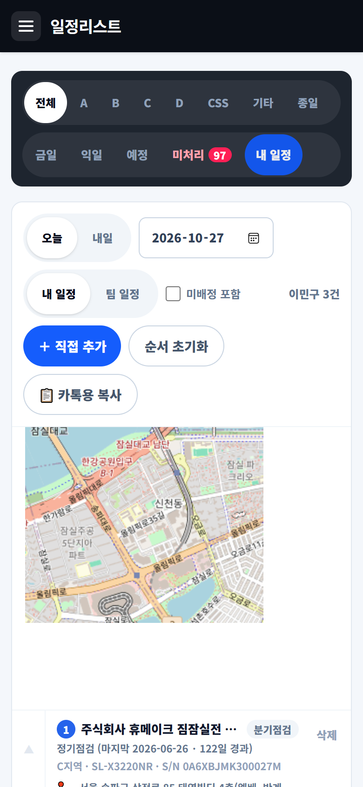
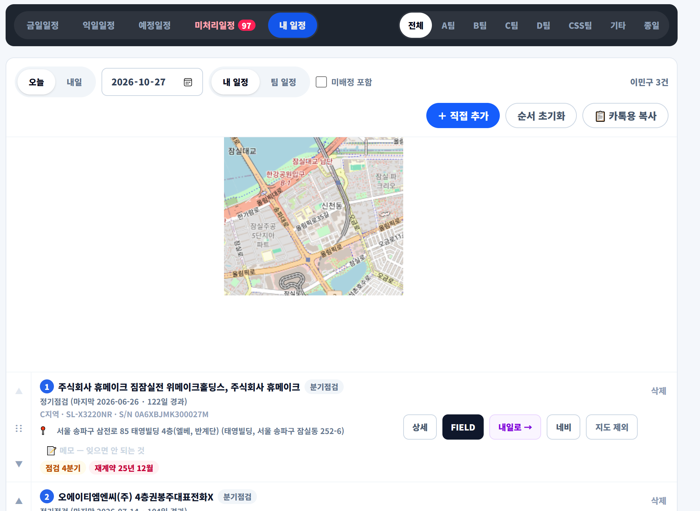
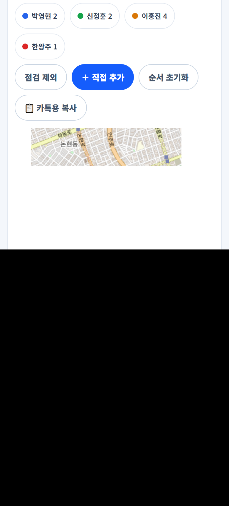
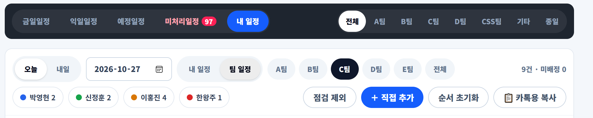
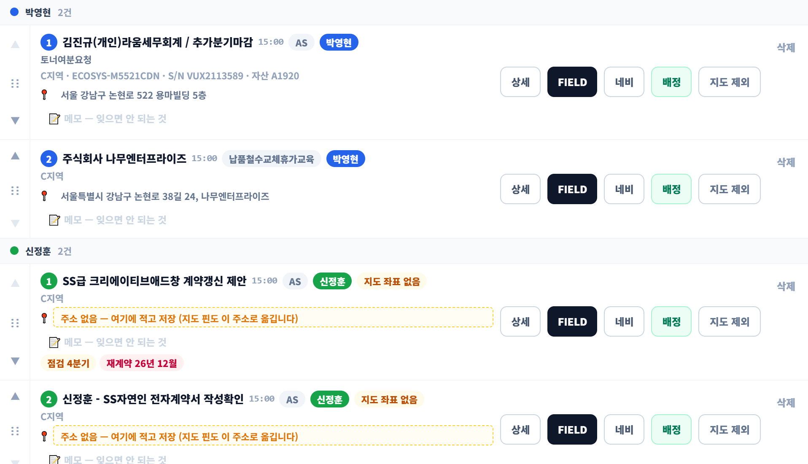
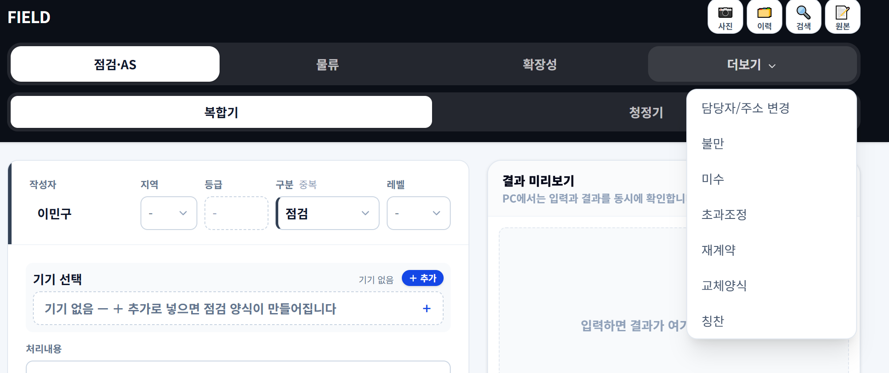
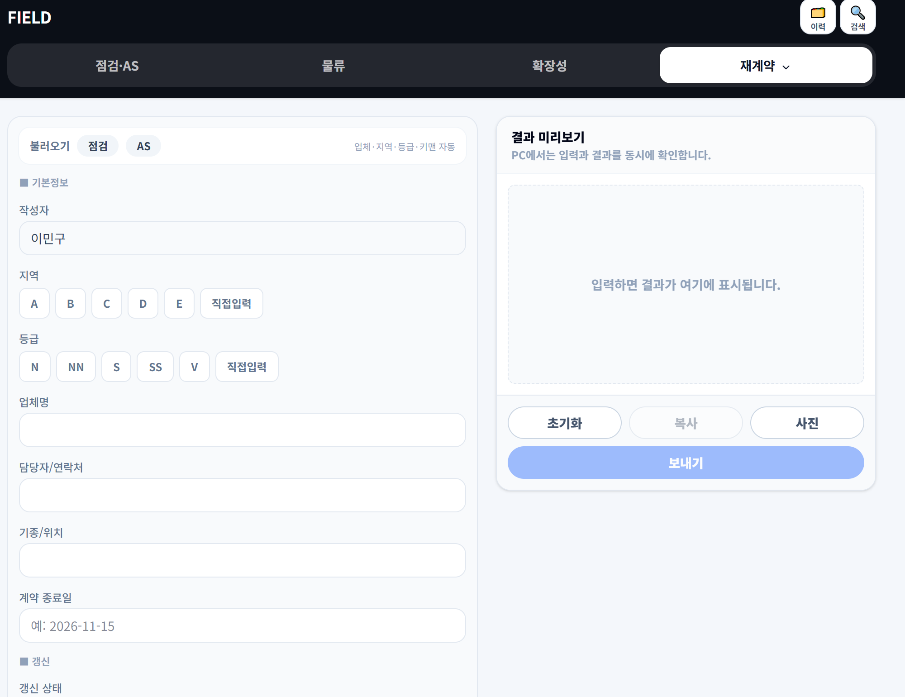
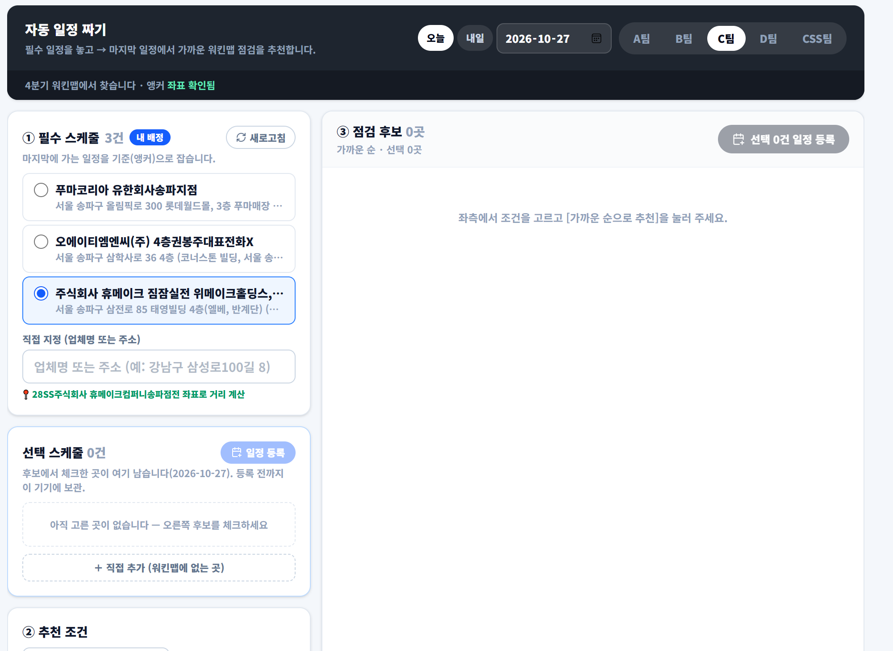

# 16. 내 일정 · 팀 일정 지도 — 처음 쓰는 직원용 (2026-10-27)

> 배포용 요약(실제 화면 캡처 2026-10-27, 그림은 ../img/myplan/). 긴 설명은 07장(일정리스트·캘린더)과 05장(재계약 양식)에 있습니다. 공유 페이지: https://claude.ai/artifact/7bVsbf51ofiG4NnR8m8oXS

## 1. 내 일정 열기
1. 왼쪽 메뉴 **일정리스트** → 위 칩 **[내 일정]**.
2. 화면이 둘로 나뉩니다. **위 절반 = 지도**(핀마다 번호), **아래 절반 = 목록**(같은 번호). 번호가 오늘 도는 순서이고 핀 사이 파란 선이 동선입니다.
3. 날짜는 위 **[오늘] [내일]** 또는 날짜 칸. 오후 4시 뒤에 열면 자동으로 다음 영업일이 먼저 보입니다.
4. 핀을 누르면 업체 이름 말풍선, 목록 줄을 누르면 지도가 그 핀으로 갑니다.

## 2. 팀 일정 보기 (파트장·팀원 누구나)
1. 같은 화면에서 **[팀 일정]** 으로 바꾸고 팀 칩 **전체 · A · B · C · D · CSS** 를 고릅니다.
2. **사람마다 색이 다릅니다.** 핀·동선·목록 색이 같은 사람이면 같은 색. 핀 아래 이름표는 담당자 이름. **미배정은 흰 점선 핀**이고 동선 없음.
3. 위 **범례(이름 칩)** 를 누르면 그 사람을 지도·목록에서 잠깐 숨깁니다(다시 누르면 보임).
4. 팀 일정은 **필수 일정(AS·익일AS·납품 등)만** 먼저 보입니다. 정기점검까지 보려면 **[점검 포함]** 을 켭니다.
5. 번호는 **사람마다 1·2·3…** 따로 매깁니다. 미배정 2건이면 1·2, 홍길동 3건이면 1·2·3.

## 3. 순서 바꾸기 (2026-10-27 새 방식 — [고정] 단추 없음)
1. 목록 줄 왼쪽 **⋮⋮ 손잡이**를 잡고 끌어 놓습니다. 폰은 **0.25초 길게 누른 뒤** 끌기(짧게 떨림). PC 마우스는 바로.
2. 끌기가 번거로우면 손잡이 위아래 **▲ ▼** 단추.
3. 놓는 순간 **지금 보이는 순서 전체가 저장**되고 지도 번호·동선도 그 순서로 바뀝니다. **PC 에서 바꾼 순서가 폰에도** 보입니다(같은 이름으로 쓸 때).
4. 팀 일정은 **같은 사람 안에서만** 옮겨집니다. 다른 사람 자리에 놓으면 제자리로 돌아가고 안내가 뜹니다.
5. 처음처럼 "가까운 순"으로 되돌리려면 **[순서 초기화]**.
6. 빨간 알림 "순서를 서버에 저장하지 못했습니다"가 뜨면 그 기기에만 바뀐 것입니다. 잠시 뒤 다시 옮기면 됩니다.

## 4. 목록 줄에서 할 수 있는 것
| 단추 | 하는 일 |
|---|---|
| 상세 | 제목·주소·내용·키맨 전화. [수정]으로 고치면 네이버 캘린더도 같이 바뀜 |
| 네비 | 주소로 길찾기 앱 열기 |
| 배정 / 배정 해제 | 담당자 정하기. **인원 제한 없음**(2026-10-27). 첫 사람이 대표 |
| 지도 제외 / 지도 표시 | 전화 체크만 하면 되는 건은 지도·동선에서 빼고 목록엔 남김 |
| 메모 | 까먹지 않을 것 한 줄. 폰·PC 어디서나 보임 |
| 불러오기 | 그 업체의 지난 FIELD 양식(점검·AS)을 필드 탭에 채워 넣음 |
| 내일로 → | 못 간 일정을 다음 영업일로(사유 필수, 팀 AS방에 사유만 나감) |
| 삭제 | 일정 지우기(네이버도 같이) |
| ＋ 직접 추가 | 워킨맵에 없는 곳(마감 방문 등). 스케줄 원문을 붙여 넣으면 한 건씩 들어감 |
| 📋 카톡용 복사 | 오늘 동선을 카톡 보고문으로 복사 |

## 5. 재계약 일정 만들기 (필드 탭에서)
1. **필드 탭 → 더보기 → 재계약** 양식. [불러오기]로 업체를 채우고 기본정보·갱신·고객 상황·현재 조건·제안·다음 액션을 적습니다. **다음 확인일**은 달력에서 고르거나 [미정·글로 쓰기].
2. **[보내기]** 가 성공하면 지역 카톡방에 글이 나가고 곧바로 **"다음 확인일로 일정 만들까요?"** 창이 뜹니다.
3. 팀 · 제목(`[재계약 확인] 업체명`) · 장소(임대리스트 주소) · 내용을 확인하고 **[일정 만들기]**. 안 만들면 [안 만들기]. 창을 닫아도 24시간 안에는 다시 뜹니다.
4. 만든 일정은 **일정리스트 · 캘린더 · 네이버 캘린더 · 내 일정 지도**에 같이 생깁니다(종류 "재계약").
5. 같은 업체에 열린 재계약 일정이 이미 있으면 **"이미 재계약 일정이 있습니다"** → [그 일정을 M/D로 옮기기] / [새로 하나 더] / [취소].
6. 여러 곳을 한 번에 잡을 때는 **자동 일정** 화면에서 종류 **[재계약]** 을 고르고 후보에서 체크 → [등록]. 제목은 `재계약 업체명`, 내용 "재계약 방문"으로 내 일정에 들어갑니다.

## 6. 자주 하는 실수
- **내 일정에 안 보여요** → 날짜가 오늘인지, [내 일정]인지(팀 일정은 필수 일정만), 담당자가 나로 배정됐는지 확인.
- **팀 일정에 점검이 안 보여요** → [점검 포함] 을 켜세요.
- **순서를 바꿨는데 폰이 다르다** → 같은 작성자 이름인지, 빨간 저장 실패 알림이 없었는지.
- **같은 업체가 두 번** → 자동 일정은 같은 달 열린 점검 일정이 있으면 새로 만들지 않고 옮깁니다(15장). 직접 추가는 늘 새로 만들어지니 한 번만.
- **완료는 FIELD 전송 뒤** "일정을 정리할까요?" → [✓ 완료]. 네이버 캘린더에서 완료 체크해도 됩니다(한 곳에서만).

마지막 갱신: 2026-10-27 · 근거 src/MyPlan.tsx, src/planOrder.ts, src/CategoryForm.tsx(재계약 일정 제안), src/AutoSchedule.tsx · 자세한 장: 07(일정리스트·캘린더), 05(재계약 양식), 15(자동 일정)
